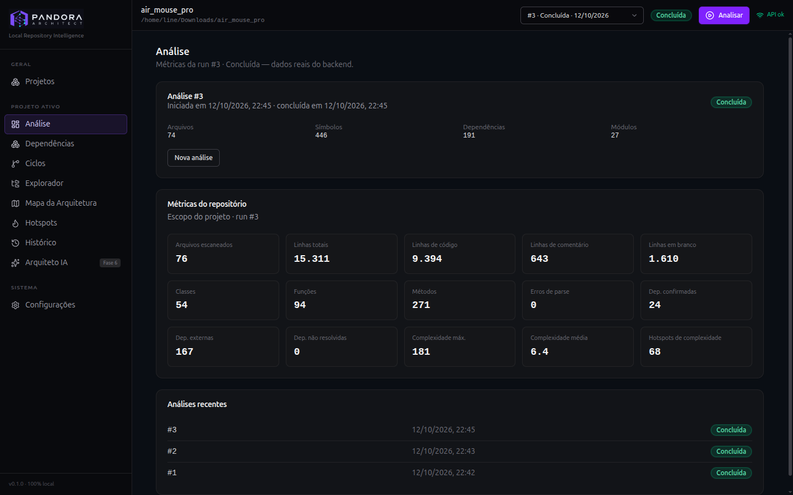
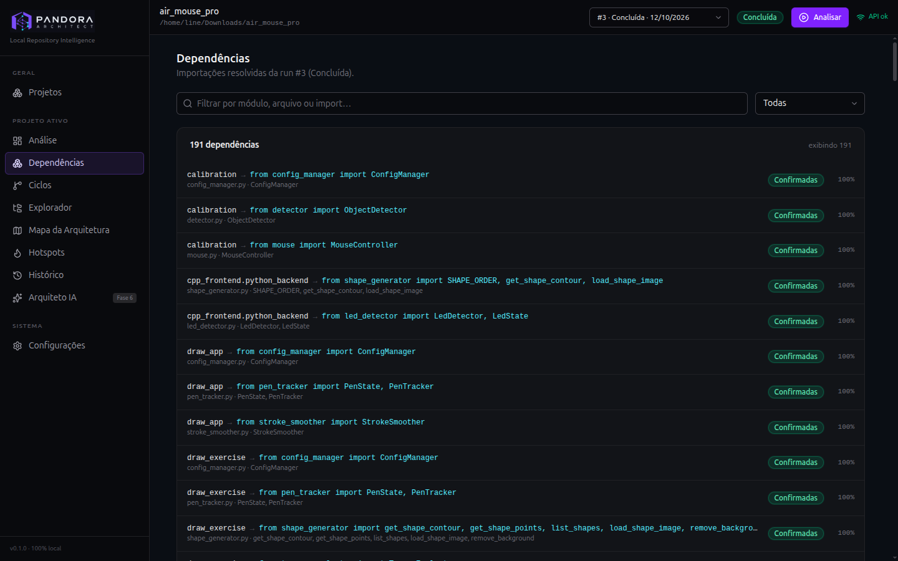
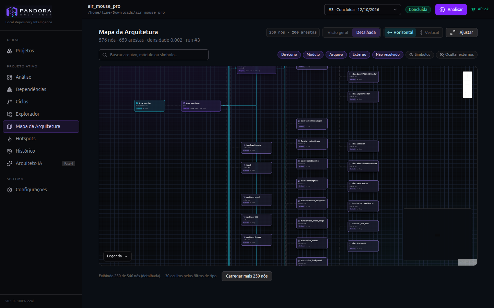
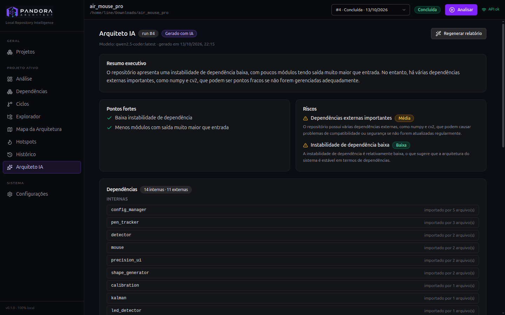
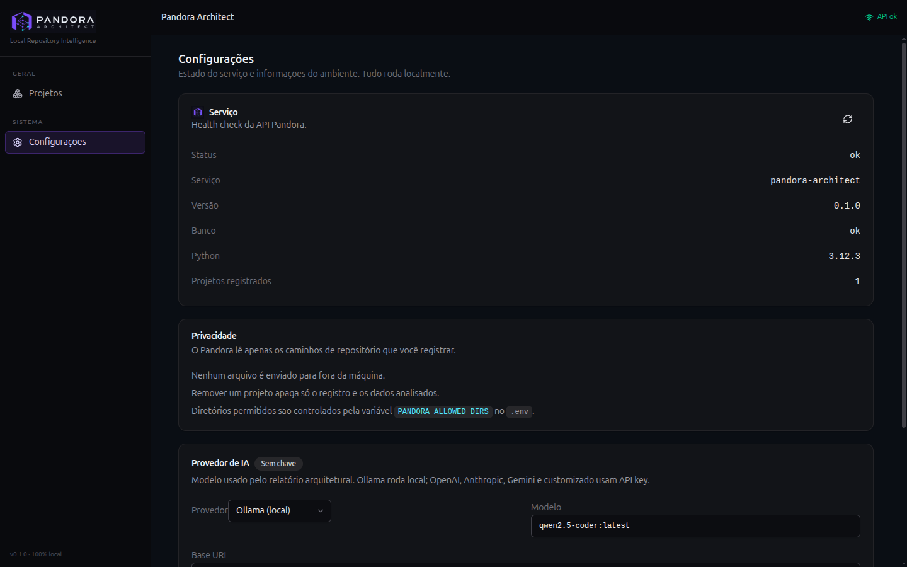

<div align="center">


# Pandora Architect

**Local Repository Intelligence**

Análise estática de repositórios, métricas e dependências — com processamento local e resultados baseados no código real.


</div>

---

## Sobre o projeto

O **Pandora Architect** é uma plataforma local de inteligência sobre repositórios de software. Basta indicar um caminho no disco para que a aplicação percorra os arquivos permitidos, analise o código e apresente informações úteis sobre a estrutura do projeto.

A plataforma reúne métricas, dependências, ciclos de dependência e exploração de arquivos em uma interface web. O objetivo é ajudar desenvolvedores a compreender a arquitetura de um repositório, identificar relações entre módulos e investigar sua organização sem depender de serviços externos.

**Privacidade por padrão:** a análise é executada localmente. O Pandora Architect não envia os dados do repositório para serviços externos e não utiliza telemetria.

### Funcionalidades disponíveis

- Cadastro e gerenciamento de repositórios locais.
- Análise estática do código e geração de métricas reais.
- Visualização e classificação de dependências.
- Identificação de ciclos no grafo de dependências.
- Explorador de diretórios e arquivos, com visualização de símbolos.
- Acompanhamento do progresso da análise em tempo real.
- Armazenamento local de dados de projetos e análises usando SQLite.
- Hotspots de complexidade com score baseado em métricas reais.
- Histórico de análises com comparação entre runs (diff de métricas, dependências e ciclos).
- Mapa da arquitetura interativo com grafo de módulos e símbolos.
- Arquiteto IA: relatório arquitetural com heurísticas determinísticas + sugestões de LLM local ou cloud (Ollama, OpenAI, Claude, Gemini).
- Configuração de provedor de IA pela interface (Ollama local, OpenAI, Anthropic, Gemini ou customizado).

Os resultados exibidos são derivados das análises executadas. Funcionalidades não implementadas são sinalizadas como tais na interface, sem preenchimento com dados simulados.

## Vislumbre da interface

Telas do Pandora Architect analisando o repositório real `air_mouse_pro` (run #3).

### Métricas do repositório

Painel com arquivos, linhas de código, classes, funções, complexidade e hotspots de complexidade.



### Dependências

Imports resolvidos e classificados a partir do código-fonte.



### Mapa da arquitetura

Grafo de módulos e símbolos com as relações entre eles — aqui, 576 nós e 659 arestas.



### Arquiteto IA

Relatório arquitetural com resumo executivo, pontos fortes, riscos, dependências internas/externas e plano de ação — gerado com heurísticas locais e, opcionalmente, LLM.



### Configurações

Provedor de IA configurável: Ollama (local), OpenAI, Anthropic (Claude), Google Gemini ou customizado — com modelo, base URL e API key.



## Tecnologias

| Camada | Tecnologias |
| --- | --- |
| Backend | Python 3.12+, FastAPI, SQLModel |
| Banco de dados | SQLite |
| Frontend | Vite, React 18, TypeScript |
| Interface | Tailwind CSS v4, shadcn/ui |
| Estado e consultas | Zustand, TanStack Query |
| Progresso em tempo real | Server-Sent Events (SSE) |
| IA (opcional) | Ollama (local), OpenAI, Anthropic, Google Gemini |

## Requisitos

- Python 3.12 ou superior.
- Node.js 20 ou superior, com npm.
- `uv` (opcional; pode acelerar a instalação do backend).
- `curl` (utilizado pelos scripts para verificar a disponibilidade da API).

## Instalação

### Linux / macOS

Na raiz do repositório, execute:

```sh
scripts/install.sh
```

O script configura o ambiente virtual do backend, instala as dependências e executa `npm ci` para instalar as dependências do frontend.

### Windows

```bat
scripts\install.bat
```

## Execução

### Linux / macOS

```sh
scripts/run.sh
```

O comando inicia a API em segundo plano e serve a versão compilada do frontend.

Para encerrar a aplicação:

```sh
scripts/stop.sh
```

Para desenvolver com recarga automática do backend e servidor de desenvolvimento do Vite:

```sh
scripts/dev.sh
```

Use `Ctrl+C` para encerrar os processos de desenvolvimento.

### Windows

```bat
scripts\run.bat
```

O script prepara o build, se necessário, e inicia a API em uma janela própria.

Após iniciar a aplicação, abra:

**http://127.0.0.1:8000/index.html**

No modo de desenvolvimento, o frontend do Vite fica disponível normalmente em `http://127.0.0.1:5173`, com proxy das chamadas `/api` para o backend na porta `8000`.

O endpoint `GET /` retorna o status do serviço em JSON. A interface web fica em `/index.html`.

## Configuração

Crie o arquivo `.env` a partir do modelo:

```sh
cp .env.example .env
```

As variáveis de configuração usam o prefixo `PANDORA_` no `.env` da raiz. Entre as opções estão host, porta, diretório de dados, nome do banco de dados, origem de desenvolvimento e limites de análise.

A variável `PANDORA_ALLOWED_DIRS` define os diretórios que o backend pode acessar. Use `:` como separador no Linux/macOS e `;` no Windows.

Além das variáveis de ambiente, o provedor de IA (Ollama, OpenAI, Anthropic, Gemini ou customizado) pode ser configurado pela interface em **Configurações**. As variáveis `PANDORA_AI_PROVIDER`, `PANDORA_AI_API_KEY`, `PANDORA_AI_BASE_URL` e `PANDORA_AI_MODEL` também funcionam via `.env`. A API key nunca é enviada de volta ao navegador.

Consulte `.env.example` para ver as opções disponíveis e seus valores esperados.

## API

A interface utiliza, entre outros, os seguintes endpoints:

| Método | Endpoint | Finalidade |
| --- | --- | --- |
| `GET` | `/api/health` | Verificar o estado da API |
| `GET`, `POST` | `/api/projects` | Listar e cadastrar repositórios |
| `GET`, `PATCH`, `DELETE` | `/api/projects/{id}` | Consultar, atualizar ou remover um projeto |
| `POST` | `/api/projects/{id}/analyze` | Iniciar uma análise |
| `GET` | `/api/projects/{id}/runs` | Consultar análises anteriores |
| `GET` | `/api/projects/{id}/explorer?path=&depth=` | Navegar pela árvore de arquivos |
| `GET` | `/api/projects/{id}/explorer/file?path=` | Consultar um arquivo e seus símbolos |
| `GET` | `/api/analysis/runs/{run_id}/summary` | Obter o resumo e as métricas da análise |
| `GET` | `/api/analysis/runs/{run_id}/dependencies` | Consultar dependências |
| `GET` | `/api/analysis/runs/{run_id}/events` | Receber eventos de progresso via SSE |
| `GET` | `/api/graph/{run_id}/cycles` | Consultar ciclos de dependência |
| `GET`, `POST` | `/api/ai/runs/{run_id}/report` | Gerar/consultar relatório do Arquiteto IA |
| `GET`, `PUT` | `/api/ai/config` | Consultar/atualizar configuração do provedor de IA |

A interface também disponibiliza endpoints adicionais. Erros são retornados em um formato estruturado com os campos `detail` e `code`.

## Estrutura do projeto

```text
pandora-architect/
├── backend/
│   ├── app/
│   │   ├── routers/     # Rotas da API
│   │   ├── analysis/    # Descoberta, parsing e métricas
│   │   ├── config.py    # Configurações
│   │   └── security.py  # Restrições e validação de caminhos
│   └── data/            # Dados locais (SQLite; ignorados pelo Git)
├── frontend/
│   └── src/
│       ├── pages/       # Páginas da aplicação
│       ├── components/  # Layout e componentes de interface
│       ├── store/       # Estado do projeto ativo
│       ├── hooks/       # Execução e progresso das análises
│       └── lib/         # Cliente HTTP, tipos e formatação
├── scripts/             # Scripts de instalação e execução
├── .env.example
└── .gitignore
```

## Roadmap

| Fase | Módulos | Estado |
| --- | --- | --- |
| 1 | Projetos, análise, dependências, ciclos e explorador | Entregue |
| 2 | Hotspots e histórico | Entregue |
| 3 | Mapa da arquitetura | Entregue |
| 6 | Arquiteto IA | Entregue |

Todas as fases do roadmap estão entregues.

## Desenvolvimento do frontend

```sh
cd frontend
npm run dev
npm run build
npm run lint
```

- `npm run dev`: inicia o Vite na porta `5173`.
- `npm run build`: executa a verificação de tipos e gera o build em `frontend/dist/`.
- `npm run lint`: executa o Oxlint.

## Princípios do projeto

- **Local-first:** os repositórios e as análises permanecem na máquina do usuário.
- **Resultados verificáveis:** métricas e relações devem vir dos dados efetivamente analisados.
- **Privacidade:** sem telemetria ou chamadas externas para enviar o conteúdo do código.
- **Transparência:** funcionalidades futuras são sinalizadas como planejadas, sem resultados fictícios.

---

<div align="center">

**Pandora Architect** · Local Repository Intelligence

</div>


## Licença

Este projeto está licenciado sob a licença MIT.
Consulte o arquivo [LICENSE](LICENSE) para obter mais informações.
